# Results index

Every measured finding, what it shows, the script that produced it, and the
caveat attached. Written to be the thing the report is drafted from, so the
numbers do not have to be reconstructed later.

Large artefacts (model weights, per-frame CSVs, overlay video) stay in `runs/`,
which is gitignored. Only summaries and figures live here.

**Image credits.** The diagnostic figures here contain annotated frames from
third-party datasets, reproduced for academic illustration of detector
behaviour. `real_crossing_escalation.jpg`, `overlay_still.jpg` and
`diagnosis_crohd_finds_them.jpg` are frames from **CroHD / HT21** (Sundararaman
et al., CVPR 2021). `diagnosis_scuthead_misses_backs_of_heads.jpg` uses
**SCUT-HEAD**. `databug_shanghaitech_2x_scaling.jpg` uses **ShanghaiTech Part A**
(Zhang et al., CVPR 2016). All overlays, boxes and labels are ours; the
underlying imagery remains the property of the respective dataset authors.
Sources and terms: [docs/datasets.md](../docs/datasets.md).

---

## 1. Detector recall vs crowding

**Headline: the training set determines the usable range, by a factor of 3.6x.**

Identical evaluation for all three models: 482 ShanghaiTech Part A images,
241,275 annotated heads, confidence 0.25.

| heads/image | SCUT-HEAD A | A+B | CroHD |
|---|---|---|---|
| 100-200 | 0.269 | 0.421 | **0.975** |
| 200-400 | 0.180 | 0.288 | **0.740** |
| 400-700 | 0.100 | 0.160 | **0.490** |
| 1200+ | 0.012 | 0.024 | **0.204** |
| usable ceiling (ratio >= 0.8) | never | never | **200 heads/image** |

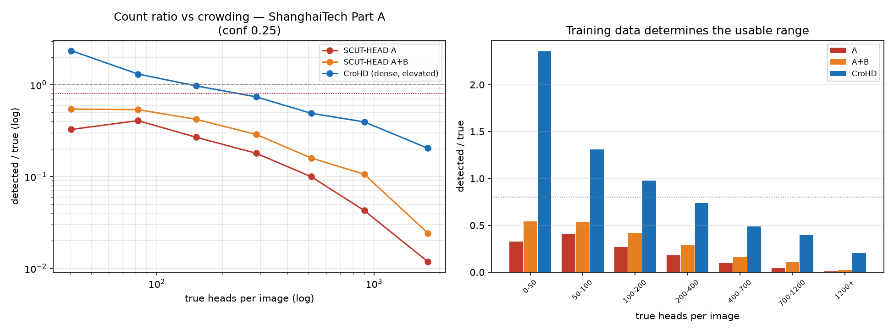

All three curves on log-log axes. The CroHD model is not merely better - it is
the only one that is ever usable, and the gap widens with density.

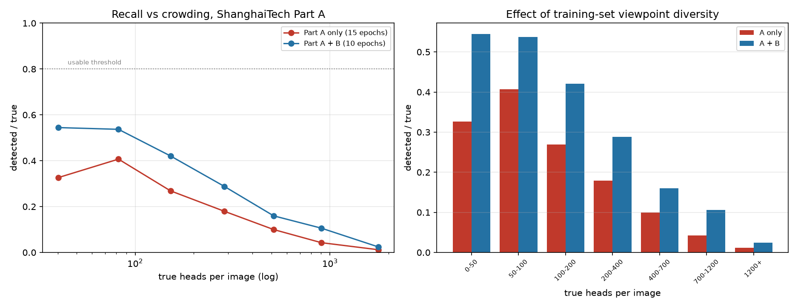

The viewpoint-diversity experiment on its own: adding SCUT-HEAD Part B roughly
doubles the count ratio at every density, which is what first suggested the
problem was the training distribution rather than the model.

| file | what it is |
|---|---|
| `recall_scuthead_A.json` | Part A only, 15 epochs |
| `recall_scuthead_AB.json` | Part A + B, 10 epochs |
| `recall_crohd.json` | CroHD, 10 epochs |
| `three_way.png` | all three curves, log-log |
| `comparison_A_vs_AB.png` | the viewpoint-diversity experiment alone |
| `recall_scuthead_testsplit.json` | SCUT-HEAD's own test split: ratio ~0.95 at every density, which is why that dataset could not reveal the problem |

Produced by `scripts/eval_point_recall.py` and `scripts/eval_dataset_recall.py`.

**Caveats.** The 0-50 bin holds only 5 images; ignore it. Count ratio cannot
separate "found them all" from "missed fifty and invented fifty". No single
confidence threshold suits all densities - sparse scenes want 0.3, extreme
density wants 0.1 - and picking the best per bin would be selecting on the
evaluation data.

## 1b. Standard detection metrics

**Headline: F1 0.720 for the delivered model against 0.107 for the first
attempt, at the deployed operating point.**

Count ratio says whether people were found; it says nothing about box quality,
and it cannot be computed against box-annotated data. These are the
conventional metrics, all three models scored identically on the held-out CroHD
scene (100 images, 17,665 boxes) at imgsz 1280, IoU 0.5, max_det 3000.

At conf 0.25, the threshold the pipeline runs at:

| model | precision | recall | F1 | mAP50 | mAP50-95 |
|---|---|---|---|---|---|
| SCUT-HEAD A | 0.314 | 0.065 | 0.107 | 0.028 | 0.006 |
| SCUT-HEAD A+B | 0.535 | 0.328 | 0.406 | 0.213 | 0.041 |
| **CroHD** | **0.747** | **0.696** | **0.720** | **0.631** | **0.202** |

At each model's own max-F1 confidence:

| model | precision | recall | F1 | mAP50 |
|---|---|---|---|---|
| SCUT-HEAD A | 0.213 | 0.131 | 0.162 | 0.053 |
| SCUT-HEAD A+B | 0.468 | 0.387 | 0.424 | 0.291 |
| **CroHD** | 0.756 | 0.688 | **0.720** | 0.723 |

**The Part A model finds 6.5% of heads.** That is what mAP50 0.938 on classroom
photographs amounts to on real elevated footage. Adding Part B roughly
quadruples F1 with no architectural change.

**The delivered model is balanced** (precision 0.747, recall 0.696); both
controls are lopsided toward precision, finding few heads and being moderately
sure of those few. For a system whose output is a count, that is the wrong
trade. Note also that conf 0.25 is near-optimal for the delivered model - its
F1 is identical at both operating points - while the controls would do better
at a lower threshold.

| file | what it is |
|---|---|
| `detection/metrics.json` | both operating points, all three models, with settings |

Produced by `scripts/eval_detection_metrics.py`.

**Caveats.** The scored scene, HT21-04, is the CroHD model's *validation* set -
its checkpoint was selected on it - so that row is an **upper bound**, not an
independent result. For the two SCUT-HEAD models the same images are entirely
unseen. This table is therefore sound evidence that the controls fail and only
indicative for the delivered model; the unbiased three-way comparison is
section 1, on ShanghaiTech, which no model trained on or was selected against.
**Accuracy is not reported and is not applicable**: detection has no
true-negative count, so the quantity is undefined.

## 2. The diagnosis

| file | what it shows |
|---|---|
| `diagnosis_scuthead_misses_backs_of_heads.jpg` | SCUT-HEAD model: almost every detection is a forward-facing person. Trained on a classroom camera facing the students, it learned faces from an elevated-front angle, not heads from any angle |
| `diagnosis_crohd_finds_them.jpg` | same two images, CroHD model: 15 -> 52 and 20 -> 63 detections |
| `databug_shanghaitech_2x_scaling.jpg` | the Kaggle re-upload had been upscaled 2x without rescaling its point labels. Red is as-stored, green is x2. Used as-is, every result from that dataset would have been silently wrong |

| SCUT-HEAD model | CroHD model |
|---|---|
| 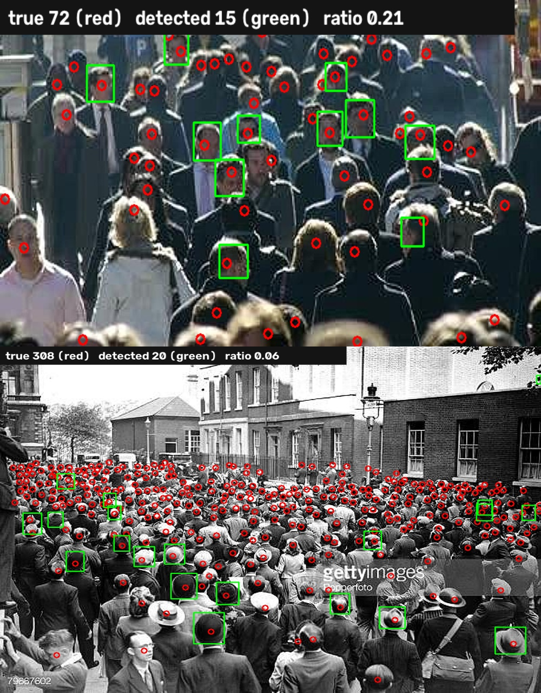 | 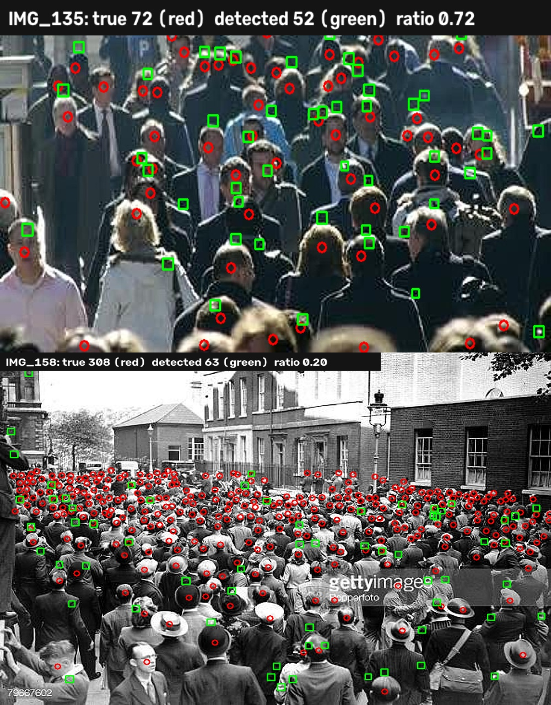 |

Same two frames, same confidence threshold, same architecture. 15 -> 52 and
20 -> 63 detections. On the left, almost every box is on a forward-facing
person; the backs and tops of heads an elevated camera mostly sees are missed.

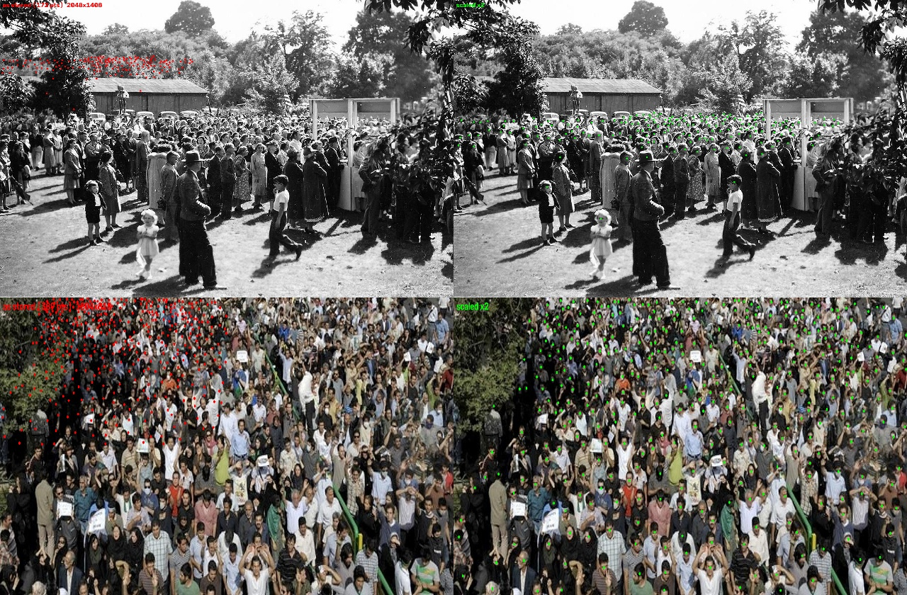

The data bug, found by checking `max_ann_x / width = 0.498` and then confirmed
visually. Red points are the annotations as stored; green are the same points
doubled. Every ground-truth head sat in the top-left quadrant, which would have
looked exactly like catastrophic recall.

## 3. Measurement validated against ground truth

**Headline: counting is biased low by a consistent 14%; speeds are within 2-5%.**

Four CroHD scenes. **Three of them are training scenes and one is held out** -
the conversion script holds out HT21-04 only - so this table measures
*agreement with ground truth*, not generalisation. Read the HT21-04 row for
that.

| sequence | split | count ratio | speed error | speed correlation |
|---|---|---|---|---|
| HT21-01 | train | 0.875 | 4.5% | 0.939 |
| HT21-02 | train | 0.886 | 2.8% | 0.996 |
| HT21-03 | train | 0.799 | 2.4% | 0.955 |
| **HT21-04** | **held out** | **0.869** | **4.6%** | 0.722 |

Count ratio across scenes: **mean 0.857, sd 0.034**. A consistent bias is
correctable; an erratic one is not.

**The held-out scene is not the worst one.** HT21-04 scores 0.869, above the
four-scene mean, while the lowest ratio (0.799) belongs to HT21-03 - a scene
the model *did* train on. Scene difficulty dominates memorisation here, which
is the reason the bias is stable enough to be worth correcting. It is also the
honest reason this table can be quoted at all: if the training scenes scored
far better than the held-out one, the mean would be meaningless.

Counting without tracking does better still: **0.977 count ratio, 4% mean
absolute error** over 40 s of HT21-04 (`count_vs_truth_timeseries.png`). Use
`detect()` for counting and `track()` for velocity - ByteTrack discards
detections it cannot associate.

| file | what it is |
|---|---|
| `crohd_summary.json` | per-sequence counts, speeds, errors |
| `validation.png` | pipeline speed vs ground-truth speed, and the first fundamental-diagram look |
| `count_vs_truth_timeseries.png` | detected vs true count over 40 s |

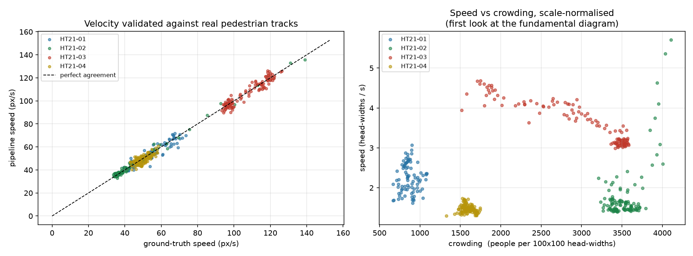

Pipeline-measured speed against ground-truth speed, and the first look at the
speed-density relationship.

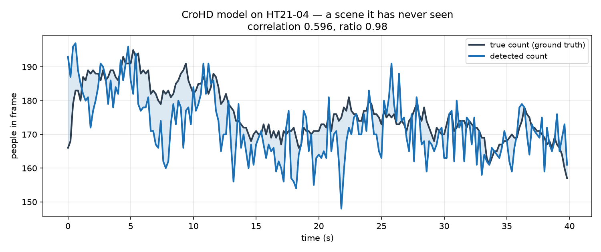

Detection-only counting against ground truth over 40 s of HT21-04. The two
traces track closely enough that the residual is a bias, not noise - which is
what makes it correctable.

Produced by `scripts/analyse_crohd.py`.

## 4. Fundamental diagram

**Headline: speed falls as density rises, in every scene with enough range -
but flow never turns over, so no critical density is locatable.**

From 1.18M person-observations of ground-truth tracks.

| sequence | slope (m/s per person/m2) | speed range |
|---|---|---|
| HT21-02 | -0.0198 | 0.41 -> 0.21 m/s |
| HT21-03 | -0.0136 | 0.71 -> 0.52 m/s |
| HT21-04 | -0.0063 | 0.35 -> 0.26 m/s |
| HT21-01 | +0.0100 | inconclusive: sparsest scene, too little density range |

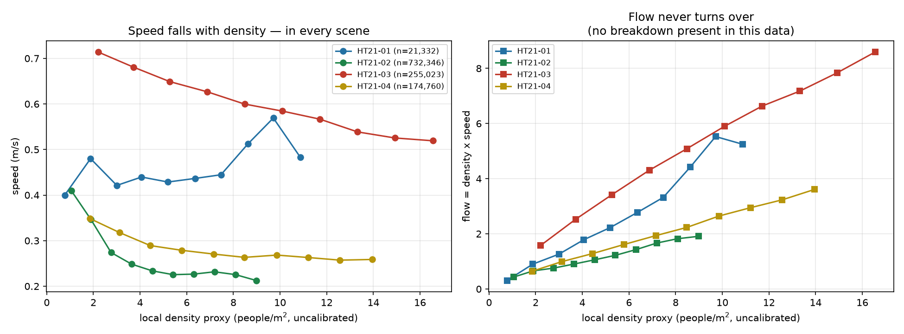

Speed falls as density rises in every scene with enough density range. Flow,
however, rises monotonically and never turns over - so the critical density,
which is the peak of that curve, is simply not present in this data.

Produced by `scripts/fundamental_diagram.py`.

**Caveats.** Density is a proxy resting on an assumed head width and a packing
constant: the shape and slope are sound, **the x-axis numbers are not - do not
quote them**. Scenes must be analysed separately; pooling them mixes "which
environment" with "how dense" and inverts the curve. Flow rises monotonically
because CroHD contains no breakdown, so the critical density is not in this
data to be found.

## 5. Flow balance

**Headline: the net occupancy rate is measurable; forecasting it is not
better than assuming nothing changes.**

Conservation check (occupancy change must equal entries minus exits):

| sequence | ground-truth tracks | pipeline tracks |
|---|---|---|
| HT21-02 | +0.5 - crossing counts sound | +0.5 |
| HT21-04 | **-12.5** | **-9.1** |

Both HT21-04 figures are biased outward, and **they have different causes.**
The pipeline's -9.1 is the expected tracker failure: a person occluded inside
the region is forgotten, returns as a first sighting (no entry counted), then
is counted leaving. The ground truth's -12.5 cannot be that, since no tracker
of ours touches it - it is identity breaks in the annotations themselves,
which is a useful reminder that hand-labelled tracks are not exact either.

The design consequence is the same from either number: the net rate is taken
from the occupancy trend, which has no such failure mode.

Forecast skill against a persistence baseline, 2816 forecasts over 133 s:

| configuration | skill at 30 s |
|---|---|
| 30 s window, raw slope | -106% |
| 30 s window, sign-gated | -42% |
| 60 s window, sign-gated + 0.5 shrinkage | **-6%** |

**Extrapolation never wins.** Gating makes it nearly harmless, not useful.
Statistical significance was the wrong gate - a slope can be significant
without persisting. Report `net_rate` as a measurement; do not present
`time_to()` as a countdown.

Produced by `scripts/flow_forecast.py`.

## 6. End-to-end demonstration

Full stack on 133 s of HT21-02: detection, tracking, velocities, occupancy,
flow balance, and a scene-relative warning rule, uncalibrated.

| file | what it is |
|---|---|
| `summary.json` | settings and level counts |
| `overlay_still.jpg` | annotated frame with the live HUD |

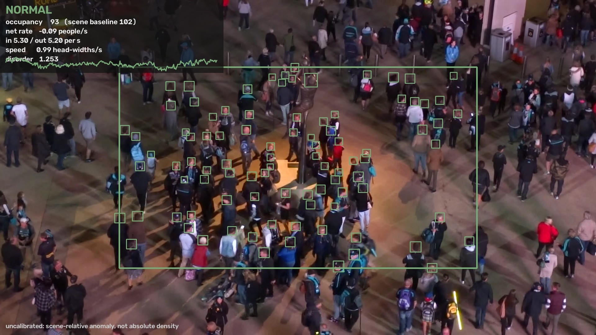

The live HUD: head boxes, the monitored region, occupancy, inflow and outflow,
and the current level.

The system reports **NORMAL throughout** (89% of frames, remainder spent
learning the baseline). That is the correct answer - HT21-02 is a steady-state
crowd where nothing unusual happens - and it is a true negative worth
reporting: a system that invented alarms on calm footage would be worse.

Escalation behaviour (NORMAL -> WATCH -> WARNING) is demonstrated separately on
the synthetic clip with exact ground truth, via `scripts/run_pipeline.py`.
No positive case exists on real footage because no public dataset contains one.

Produced by `scripts/demo_uncalibrated.py`.

## 6b. Escalation on REAL footage

**Headline: on a sequence that actually has accumulation dynamics, the system
escalates and de-escalates correctly - real model, real detections, real
crowd.**

The earlier demo on HT21-02 stayed NORMAL because that crowd is steady. HT21-03
is a street crossing, where people accumulate at the light and then discharge:

| sequence | occupancy sd | range/mean | max sustained accumulation |
|---|---|---|---|
| HT21-02 | 11.3 | 0.25 | +3.0/s |
| **HT21-03** | **78.3** | **0.92** | **+17.3/s** |

| time | transition | occupancy | inflow / outflow |
|---|---|---|---|
| 15.0 s | LEARNING -> NORMAL | 99 | 15.3 / 8.3 |
| 15.1 s | -> WATCH | 104 | 15.3 / 8.4 |
| 17.1 s | -> **ELEVATED** | 99 | 16.2 / 9.2 |
| 29.8 s | -> NORMAL | 84 | 14.6 / 12.4 |

The flow columns are the point: at escalation inflow is nearly double outflow,
so the region is filling. At de-escalation they have converged. That is the
flow-balance diagnostic behaving as designed, on real data, with no calibration
and no borrowed thresholds.

| file | what it is |
|---|---|
| `real_crossing_escalation.jpg` | one frame per state |
| `real_crossing_summary.json` | settings and level counts |

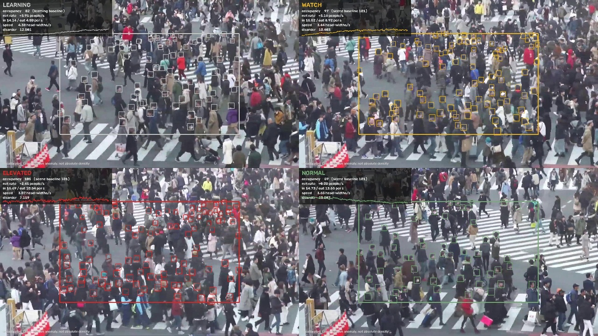

One frame per state on HT21-03. Note the inflow and outflow figures in the HUD:
nearly 2:1 at escalation, converged by the time it stands down.

**Caveat on the footage.** HT21-03 is a **training** scene for the detector, as
is HT21-02 in section 6. Detection quality in both demonstrations is therefore
optimistic relative to a new camera. This matters less than it first appears:
what is being demonstrated is the occupancy, flow-balance and escalation logic,
none of which was fitted to these scenes, and the detector's generalisation is
evidenced separately in section 1 on a dataset it never saw. But the sentence
"on footage the model never trained on" cannot be used of these two clips.

**Caveat on the baseline.** It is the 85th percentile of the first 15 s. If
that window is unrepresentative the threshold is wrong - on HT21-02 it landed
at 102 against a clip mean of 85, which is part of why that sequence never
escalated. A longer or explicitly quiet learning window would be more robust.

Hysteresis matters here: without a deadband the level flapped between NORMAL
and WATCH every few frames while occupancy sat on the threshold. Entering
requires crossing the baseline, leaving requires falling 10% below it plus a
3 s clear time.

## 7. Synthetic calibrated scenario

**Headline: given calibrated footage of a deteriorating crowd, the system
escalates correctly and de-escalates correctly.**

FABRICATED. Geometry, people and movement were generated by
`scripts/make_scenario_clip.py`; the clip is watermarked on every frame. It is
not evidence about real crowds. It exists because the real footage available
(CroHD) contains only ordinary functioning crowds, so the warning logic
correctly stays quiet and never demonstrates its escalation.

Camera geometry mimics the real demonstration. Declared region 6.0 x 5.0 m =
30.0 m^2, recovered exactly by the homography.

| time | transition | reason |
|---|---|---|
| 0.00 s | NORMAL | LOS A |
| 25.72 s | -> WATCH | LOS D and pressure rising, holding 0.0 s of 2.0 s |
| 27.72 s | -> **WARNING** | both signals, sustained 2.0 s |
| 53.12 s | -> WATCH | LOS E but pressure no longer rising |

One episode, 27.72-53.08 s (25.4 s), peak density 3.93 people/m2, peak
pressure 0.686.

The stand-down is the two-signal rule working as intended: at 53 s the crowd
is still dense (LOS E) but has stopped deteriorating, so the system
de-escalates instead of latching. A density-only rule would still be firing.

| file | what it is |
|---|---|
| `scenario_escalation.jpg` | one frame at each state |
| `scenario_episodes.json` | the episode with start, end and peaks |

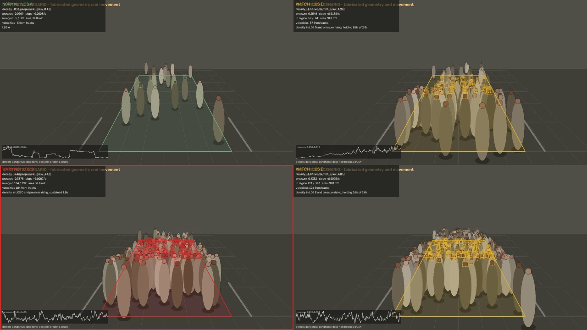

One frame at each state, with density in people/m2 on the HUD because this clip
is calibrated. The FABRICATED watermark is on every frame deliberately: this is
the only place in the project where a full escalation can be shown, and it must
never be mistaken for footage of a real crowd.

**`pressure_slope_threshold` was derived, not guessed.** Swept 0.002-0.015
against the criterion "lowest value producing zero warnings during the calm and
ramp-up segment that still fires during the deterioration". Everything from
0.002 to 0.010 met it identically; 0.015 never fired. 0.005 was chosen, inside
the range rather than at an edge. Recorded in
`configs/thresholds_scenario.yaml`. The 0.02 default in
`configs/thresholds.yaml` is a placeholder and is too high for this scene -
expected behaviour for a scale-dependent parameter, and the reason the
procedure in `docs/calibration.md` section 6 exists.

**Detection is replayed from ground truth.** This exercises calibration,
density, crowd pressure and the warning rule without detector error. The
trained detector finds nothing in synthetic imagery, so it cannot be in this
loop.

---

## What none of this shows

- that the system detects or predicts a crush. No public dataset contains one,
  so the warning layer has never been tested against the event it is named for
- absolute density in people/m2 without a surveyed camera
- that any threshold is correct. The Fruin bands remain unverified against a
  primary source, and `pressure_slope_threshold` was set by a sweep on the
  **fabricated** scenario (section 7), never against real footage - because no
  real footage available to this project contains the condition it is meant to
  detect. It is a value derived under conditions we invented, not a measured
  property of crowds.
